<div align="center">

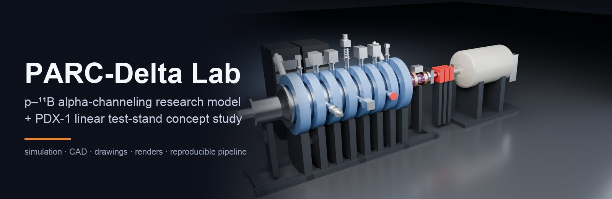

<br>

[](https://github.com/aditbytes/PARC-Delta-Lab/actions/workflows/ci.yml)
[](https://github.com/aditbytes/PARC-Delta-Lab/actions/workflows/codeql.yml)
[](https://github.com/aditbytes/PARC-Delta-Lab/releases/latest)
[](parc-delta/pyproject.toml)
[](parc-delta/tests)
[](https://github.com/astral-sh/ruff)
[](LICENSE)

**An open, reproducible research codebase for steering fusion-alpha energy into fuel ions —<br>
from kinetic plasma models to a fully simulated, CAD-modelled bench test stand.**

[Quickstart](#quickstart) ·
[Results](#results-at-a-glance) ·
[Gallery](#gallery) ·
[Architecture](#architecture) ·
[Research model](#the-research-model-parc-delta-v16) ·
[Deliverables](deliverables/README.md) ·
[Release v1.6.0](https://github.com/aditbytes/PARC-Delta-Lab/releases/tag/v1.6.0)

</div>

---

> [!IMPORTANT]
> **This is a concept study, not a reactor.** Nothing here establishes fusion gain, net electricity,
> low-cost power or a new energy-generation mechanism. PDX-1 is not engineered for fabrication, and the
> closed-loop scheduler is the *hypothesis under test*, not a demonstrated result.
> See the [claims boundary](#claims-boundary).

## Overview

**PARC-Delta Lab** has two parts that share one set of physics and one set of design parameters:

| | What it is | Highlights |
|---|---|---|
| 🧪 **[`parc-delta/`](parc-delta)** | **PARC-Delta v1.6**: an exploratory p–¹¹B alpha-channeling research model. Linear and finite-k∥ ion-Bernstein-wave (IBW) kinetics, sequential p–¹¹B → 3α birth kinematics, conserving Coulomb Monte Carlo, and time-dependent Rosenbluth / Takizuka–Abe / Nanbu alpha slowing-down. | 12 modules · **76 tests** · six archived campaigns (v1.1→v1.6) · SHA-256-verified release |
| 🔧 **[`prototype/`](prototype)** | **PDX-1**: a concept bench-scale linear magnetized test stand, designed, simulated and rendered from a single parameter file. Magnet, full-orbit alpha confinement, bench physics, CAD, engineering drawing, renders, report, deck and video. | 3 T REBCO mirror · 4,200 Boris-pushed alphas · 150-part STEP · A0 drawing · 11 tests (T1–T11) |

<div align="center">
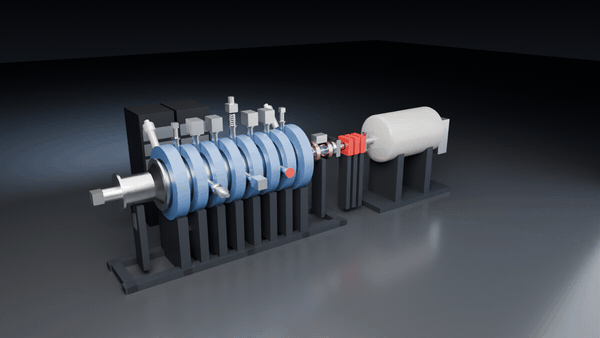
<br><sub><b>PDX-1</b>: 6.9 m linear mirror · 0.675 MeV protons → 1 µm ¹¹B foil at the centre of a 3 T HTS magnet (Blender Cycles render of the CAD model)</sub>
</div>

## Results at a glance

Every number below is regenerated by `make all` and recorded in
[`deliverables/data/results_summary.json`](deliverables/data/results_summary.json).

| ID | Area | Test | Result | Status |
|:--:|---|---|---|:--:|
| T1 | Software | PARC-Delta v1.6 unit + regression suite | 76 / 76 passed | ✅ pass |
| T2 | Reproducibility | Independent re-run of the full v1.6 campaign | 1,122 values in 11 files; max relative difference **7.5 × 10⁻¹⁰** | ✅ pass |
| T3 | Physics | Collision-operator cross-checks | single bath agrees to < 0.003 %; full mixture captures only 92.9 % / 93.9 % of energy loss | ⏳ open |
| T4 | Magnet | HTS coil set: field, mirror ratio, stored energy | B₀ 3.00 T, mirror ratio 1.63, 14.2 MJ, peak winding field 10.0 T | 🔁 design change |
| T5 | Orbit solver | Boris integrator vs adiabatic loss-cone theory | simulated end loss **39.67 %** vs analytic **39.69 %** | ✅ pass |
| T6 | Confinement | Alpha wall loss vs central field (1–4 T) | 76 % at 1 T → **0.1 %** at 3 T (design point) | ✅ pass |
| T7 | Target | Re-intersection of trapped alphas with the target | 38 % hit the target assembly within 4 µs | 🔶 finding |
| T8 | Collisions | Alpha slowing-down in the bench plasma | 3.1 MeV → 50 keV in 11.7 ms; 99.94 % to electrons | ✅ pass |
| T9 | Feasibility | Fast-alpha inventory vs IBW drive requirement | best case 2.3 × 10⁸ m⁻³ vs 2 × 10¹⁷ m⁻³ needed (~10⁹× short) | 🔶 finding |
| T10 | RF | IBW channel plan and resonance layers | Ωα/2π = 23.0 MHz, Ωp/2π = 45.7 MHz; channels 57.6–126.6 MHz | ✅ pass |
| T11 | CAD | Model integrity and drawing traceability | 150 labelled parts, 6.9 × 3.2 × 2.4 m; A0 drawing PDX1-GA-001 | ✅ pass |

<sub>✅ pass · 🔁 design changed because of the test · 🔶 finding that reshapes the programme · ⏳ open validation gate</sub>

**What the simulations changed:** the ~10 T mirror-coil winding field ruled out NbTi at 4.2 K, so the
baseline moved to **REBCO HTS at 20 K** (T4). An on-axis foil re-intersects trapped alphas within
microseconds (T7), so pulsed/retractable or gas targets are needed. Fusion-born alphas from a µA beam are
~10⁹× too sparse to drive IBWs (T9), so **Phase 2 needs a surrogate energetic-ion source.**

## Gallery

### Device

| Hero render | Annotated cutaway | Annotated detail |
|:--:|:--:|:--:|
| 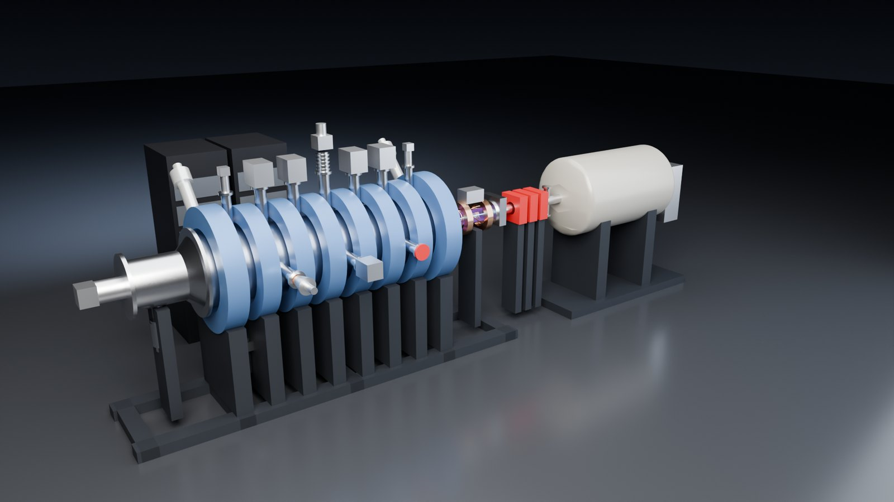 | 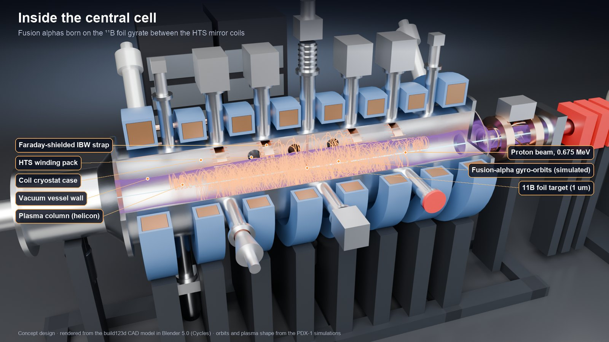 | 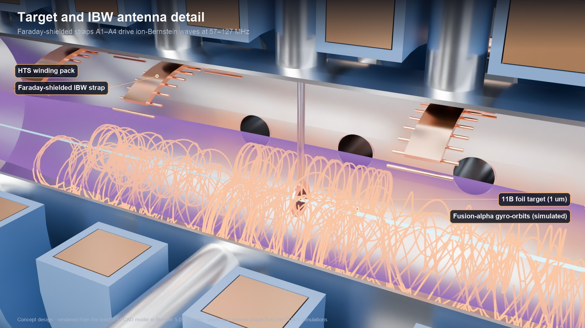 |

<div align="center">
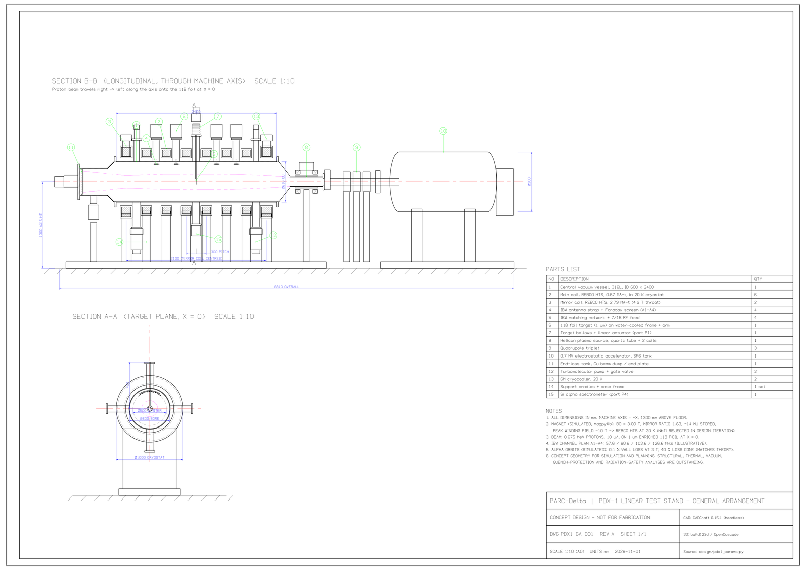
<br><sub><b>PDX1-GA-001</b>: general arrangement, longitudinal section B-B and cross-section A-A at 1:10 on A0, generated headlessly in CADCraft (<a href="deliverables/drawing/PDX1-GA-001.pdf">PDF</a> · <a href="deliverables/drawing/PDX1-GA-001.dxf">DXF</a>)</sub>
</div>

### Simulations

| Magnet: on-axis field and coil layout | Magnet: \|B\| map and flux surfaces |
|:--:|:--:|
| 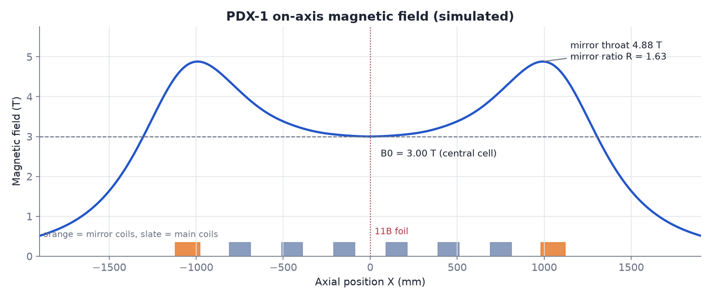 | 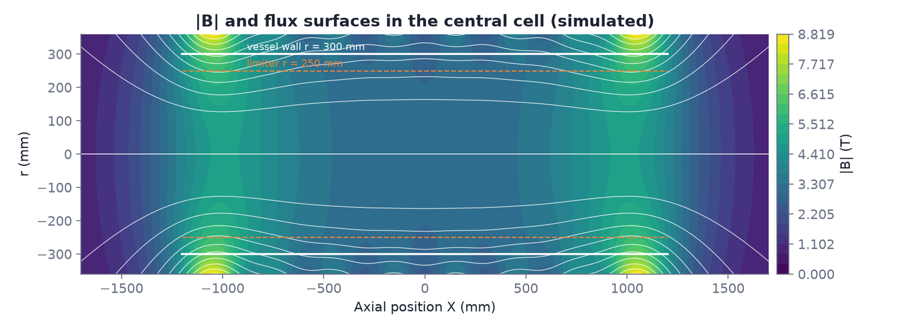 |
| **Alpha orbits: side and end views** | **Birth phase space and fate at 3 T** |
| 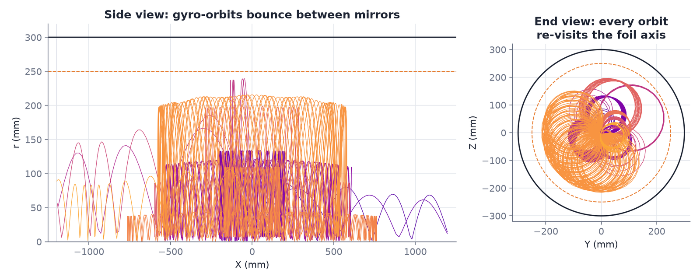 | 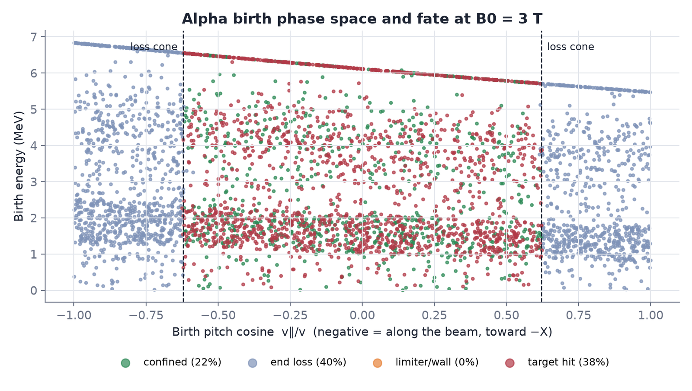 |
| **Alpha fate vs central field** | **Target offset trade-off** |
| 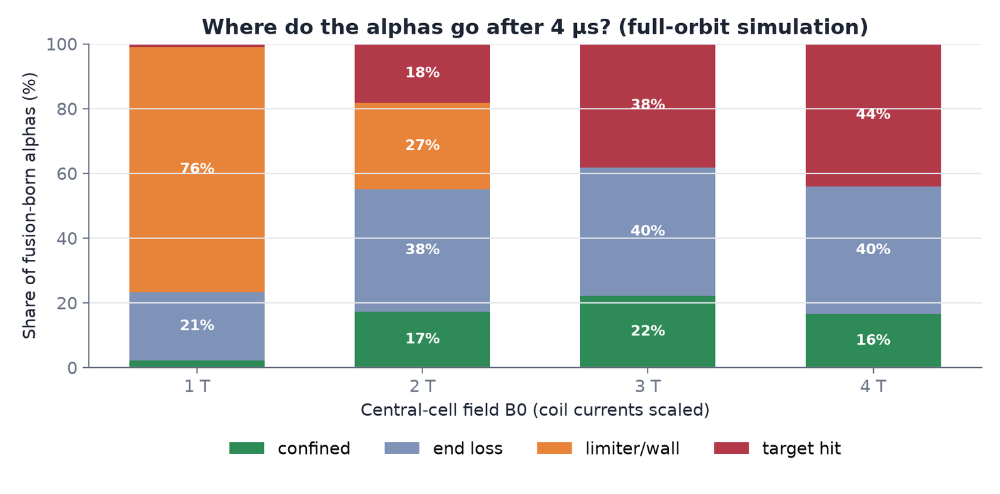 | 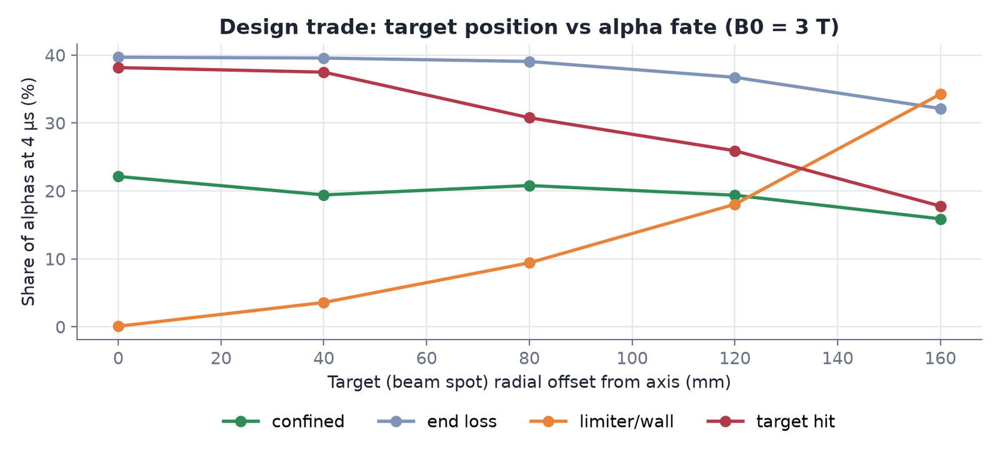 |
| **Slowing-down in the bench plasma** | **Fast-alpha budget vs IBW drive** |
| 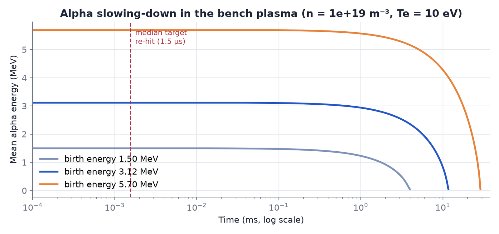 | 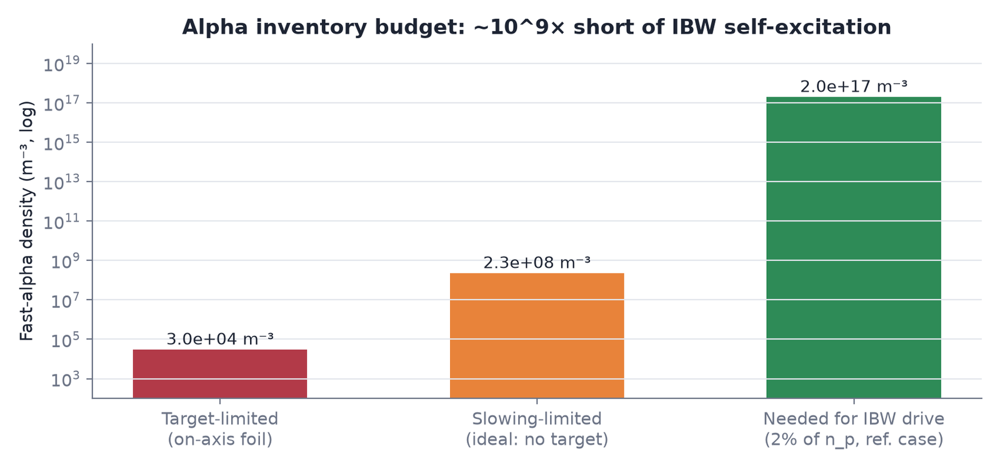 |

<details>
<summary><b>More charts:</b> resonance map and fate history</summary>

| IBW resonance map | Alpha fate history |
|:--:|:--:|
| 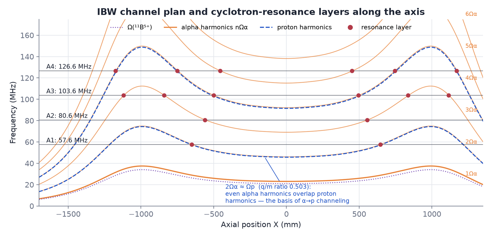 | 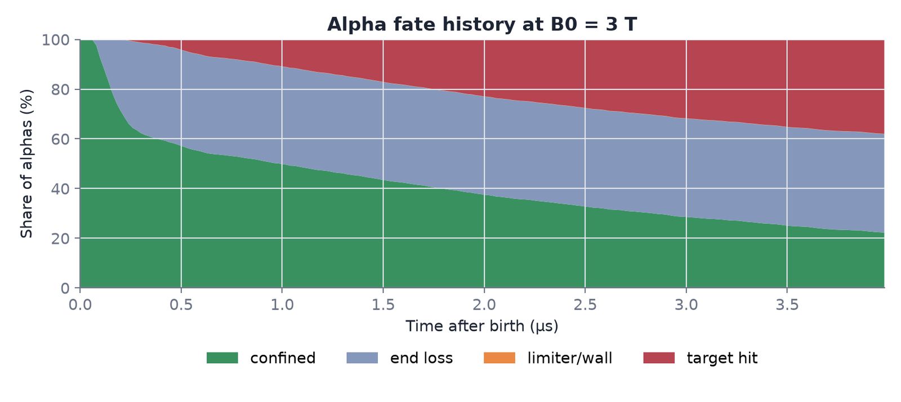 |

</details>

### System design

| Architecture | Closed-loop scheduler (hypothesis) |
|:--:|:--:|
| 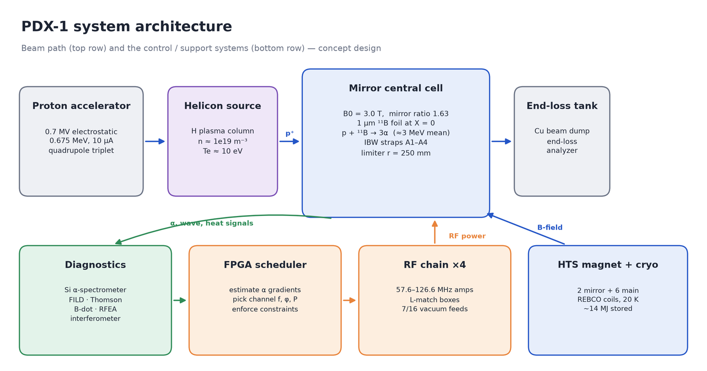 | 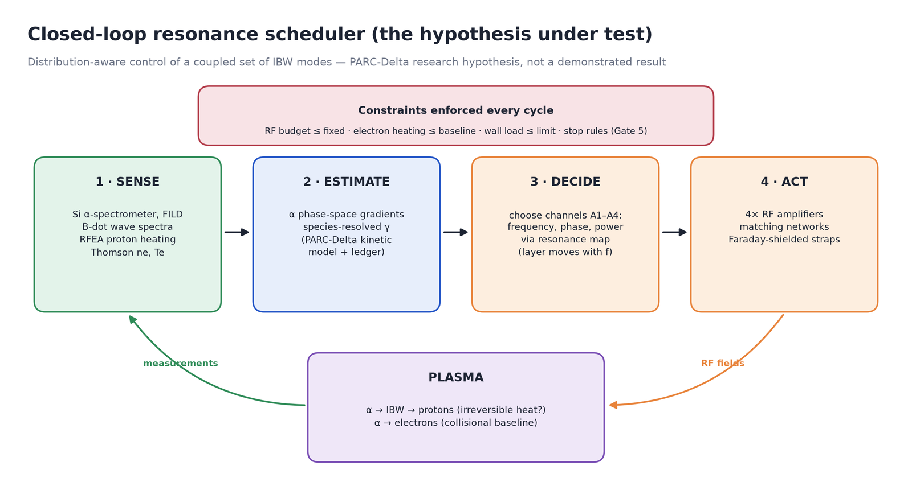 |
| **Alpha energy flow** | **Validation ladder** |
| 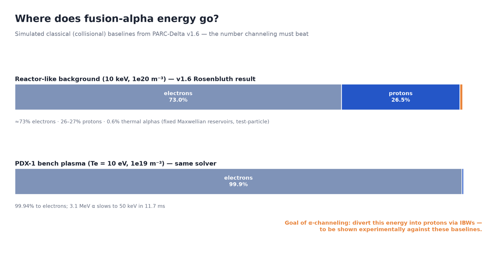 | 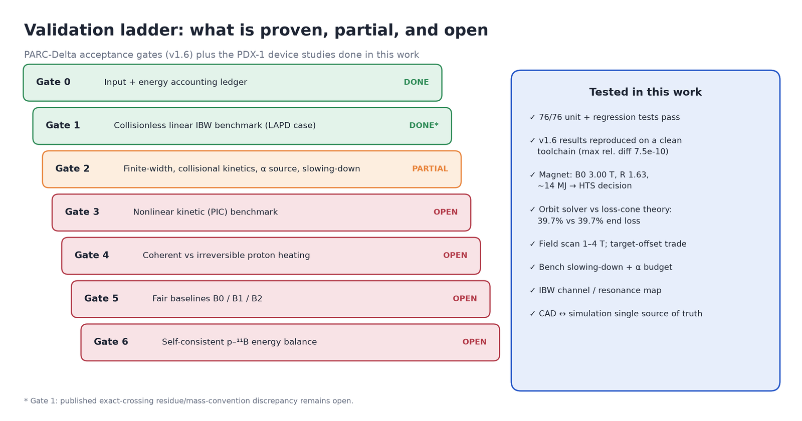 |

<details>
<summary><b>Roadmap</b></summary>

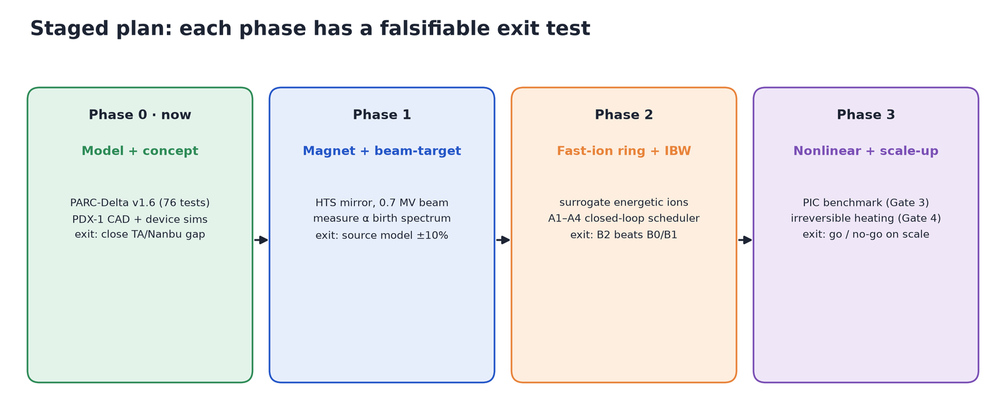

</details>

## Architecture

Every geometric and physical input flows from **one file**,
[`prototype/design/pdx1_params.py`](prototype/design/pdx1_params.py), so the CAD model, the drawing
and every simulation always describe the same machine. The research package supplies the alpha birth
source and collision physics.

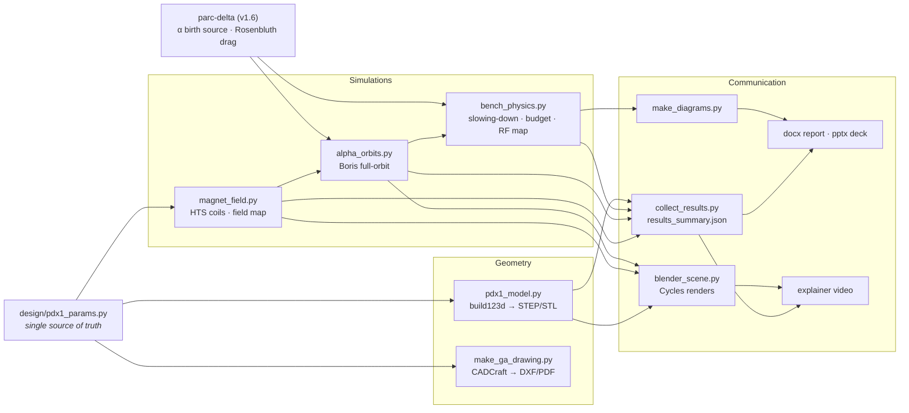

More detail in [`docs/ARCHITECTURE.md`](docs/ARCHITECTURE.md).

## Quickstart

```bash
git clone https://github.com/aditbytes/PARC-Delta-Lab.git
cd PARC-Delta-Lab
python3 -m venv .venv && source .venv/bin/activate

make install    # research package + prototype dependencies
make check      # lint + SHA-256 integrity + 76 tests + CLI smoke test
make sims       # magnet → alpha orbits → bench physics (~35 s)
make report     # + CAD, then results_summary.json
```

Use the research model directly:

```python
from parc_delta_v10.pb11_alpha_source import sample_pb11_alpha_birth
from parc_delta_v10.slowing_down import MaxwellianFieldSpecies, rosenbluth_test_particle_coefficients
from parc_delta_v10.linear_ibw import LAPDReferenceCase, run_reference_case
```

```bash
# Evaluate a JSON energy-ledger snapshot (the bundled example is a synthetic fixture)
cd parc-delta && PYTHONPATH=src python -m parc_delta_v10.cli examples/synthetic_unit_test_snapshot.json
```

### Full pipeline

`make all` rebuilds every artifact. Stages beyond the simulations need external tools:

| Stage | Command | Requires |
|---|---|---|
| Tests, integrity, rerun | `make check` · `make rerun` | Python ≥ 3.10 |
| Simulations | `make sims` | numpy, scipy, matplotlib, magpylib |
| CAD | `make cad` | build123d (OpenCascade) |
| Drawing | `make drawing` | [CADCraft](https://github.com/storytold/cadcraft) `cadcraft-cli` (`CADCRAFT_CLI=…`) |
| Renders | `make renders` · `make turntable` | Blender 4.x/5.x (`BLENDER=…`) |
| Diagrams, report | `make diagrams` · `make report` | Python |
| Report + deck | `make docs` | Node ≥ 20 |
| Video | `make video` | ffmpeg, macOS `say` |
| README imagery | `make assets` | Pillow, ffmpeg |

Step-by-step instructions and expected timings are in [`docs/REPRODUCIBILITY.md`](docs/REPRODUCIBILITY.md).

## The research model: PARC-Delta v1.6

The [`parc-delta/`](parc-delta) package is the 1.6.0-research release, kept **byte-identical** to its
[SHA-256 manifest](parc-delta/SHA256SUMS.txt) (checked in CI). Each version added one validated layer:

| Version | Layer | Design note |
|---|---|---|
| v1.0 | Instantaneous energy ledger, wave-mode snapshots, CLI | [MODEL_SPEC](parc-delta/docs/MODEL_SPEC.md) · [INPUT_CONTRACT](parc-delta/docs/INPUT_CONTRACT.md) |
| v1.1 | Reproduction of the published collisionless perpendicular p–α IBW model | [v1.1](parc-delta/docs/PUBLISHED_MODEL_REPRODUCTION_v1.1.md) |
| v1.2 | Mass convention, finite alpha energy width, pole broadening | [v1.2](parc-delta/docs/MASS_CONVENTION_AND_FINITE_WIDTH_v1.2.md) |
| v1.3 | Finite-k∥ kinetic susceptibility (Harris + gyrotropic alpha ring) | [v1.3](parc-delta/docs/FINITE_KPARALLEL_KINETIC_v1.3.md) |
| v1.4 | Sequential p–¹¹B → 3α birth kinematics; conserving Coulomb MC | [source](parc-delta/docs/PB11_ALPHA_BIRTH_SOURCE_v1.4.md) · [MC](parc-delta/docs/COULOMB_MC_OPERATOR_v1.4.md) |
| v1.5 | Landau–Spitzer collision-rate validation | [v1.5](parc-delta/docs/COLLISION_RATE_VALIDATION_v1.5.md) |
| v1.6 | Time-dependent Rosenbluth slowing-down; TA/Nanbu comparators | [slowing-down](parc-delta/docs/ALPHA_SLOWING_DOWN_v1.6.md) · [subcycling](parc-delta/docs/MULTISPECIES_SUBCYCLING_v1.6.md) |

**Headline v1.6 result (classical collisional baseline):** in a fixed 10 keV electron/proton/thermal-alpha
background, alpha mean energy falls from ≈ 3.11 MeV to ≈ 15 keV over 1 s, depositing **≈ 73 % to electrons,
26–27 % to protons and 0.6 % to thermal alphas.** This is the baseline any channeling scheme must beat.
Full details: [`RELEASE_REPORT.md`](parc-delta/RELEASE_REPORT.md) ·
[acceptance gates](parc-delta/docs/ACCEPTANCE_GATES.md) ·
[prior art and hypothesis](parc-delta/docs/PRIOR_ART_AND_HYPOTHESIS.md).

## Repository layout

```text
PARC-Delta-Lab/
├── parc-delta/                 # PARC-Delta v1.6 research package (SHA-256 locked)
│   ├── src/parc_delta_v10/     #   12 physics + accounting modules
│   ├── tests/                  #   76 tests
│   ├── scripts_run_v1*.py      #   campaign runners v1.1 → v1.6
│   ├── results/                #   archived campaign outputs
│   └── docs/                   #   per-version design notes, acceptance gates
├── prototype/                  # PDX-1 concept study pipeline
│   ├── design/                 #   pdx1_params.py (single source of truth), plot style
│   ├── sim/                    #   magnet, alpha orbits, bench physics
│   ├── cad/  drawings/         #   build123d model, CADCraft GA drawing
│   ├── renders/  diagrams/     #   Blender scene + callouts, system diagrams
│   ├── report/  docs/  video/  #   results collector, docx/pptx generators, video
├── deliverables/               # curated results, drawing, parts list, captions
├── docs/                       # architecture, reproducibility, results, README assets
├── scripts/                    # integrity check, README asset generator
├── requirements/               # prototype + dev dependency sets
├── .github/                    # CI, CodeQL, release, templates, Dependabot
└── Makefile                    # one entry point for every stage
```

## Open questions

The study's most valuable output is a precise list of what remains unknown. Highlights:

1. **Collision closure.** Why do TA/Nanbu still miss 6–7 % of the Rosenbluth alpha energy loss at 32 substeps?
2. **Alpha drive.** Which surrogate energetic-ion source reaches n_fast/n_p ≈ 1 % at bench scale?
3. **Coherent vs irreversible heating.** How does PDX-1 separate them (Gate 4)?
4. **Nonlinear physics.** Does the multi-mode advantage survive saturation and mode coupling (Gate 3, PIC)?
5. **Magnet engineering.** ~10 T at the REBCO mirror coils and a ~170 MPa J×B×R screen need FEA and vendor input.

All ten are listed in [`docs/RESULTS.md`](docs/RESULTS.md#open-questions).

## Claims boundary

| We have shown | We do **not** claim |
|---|---|
| A reproducible alpha-channeling research model (76/76 tests, rerun agreement 7.5 × 10⁻¹⁰) | Fusion gain, net electricity or low-cost power |
| A concept test stand whose geometry and physics come from one source | That PDX-1 is a reactor or ready to fabricate |
| A validated orbit solver and simulation-driven design decisions | That the scheduler works: it is the hypothesis under test |
| An honest map of the hard problems, found before buying hardware | Novelty over the prior art on alpha channeling itself |

## Contributing

Contributions are welcome. Please read [`CONTRIBUTING.md`](CONTRIBUTING.md) and the
[Code of Conduct](CODE_OF_CONDUCT.md). Run `make install-dev` once to install the pre-commit hooks, and
`make check` before opening a pull request. Security issues: see [`SECURITY.md`](SECURITY.md).

## Citation

If this work is useful in your research, please cite it via [`CITATION.cff`](CITATION.cff)
(GitHub shows a **Cite this repository** button in the sidebar).

## License

Released under the [MIT License](LICENSE). Third-party tools used by the pipeline (Blender, CADCraft,
build123d/OpenCascade, magpylib, pptxgenjs, docx) are installed separately and keep their own licenses.
