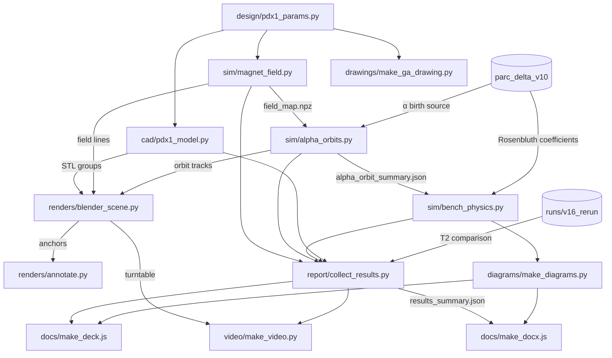

# Architecture

PARC-Delta Lab is two codebases joined by one dependency edge: the PDX-1 prototype pipeline imports
physics from the PARC-Delta research package.

## Design principles

1. **One source of truth.** Every dimension, field target and beam parameter of PDX-1 lives in
   [`prototype/design/pdx1_params.py`](../prototype/design/pdx1_params.py). CAD, the drawing, the
   magnet solve and the orbit pusher all import it, so they can never disagree about the machine.
2. **Physics reuse, not re-implementation.** The orbit and bench simulations take the alpha birth
   source and Rosenbluth coefficients straight from `parc_delta_v10`, so device results inherit the
   research model's tests.
3. **Frozen research release.** `parc-delta/` is byte-identical to the 1.6.0-research release and is
   verified against `SHA256SUMS.txt` in CI. Changes to it are new research versions, not edits.
4. **Every stage writes only to its own `out/`.** Outputs are generated, git-ignored and reproducible;
   curated copies live in [`deliverables/`](../deliverables) and the release.
5. **Claims are bounded in code and docs.** Modules state their scope in their docstrings; the
   report generator emits an explicit claims boundary.

## Coordinate conventions

| Context | Axis | Units |
|---|---|---|
| CAD and drawing | machine axis = +X, Z up, axis height 1300 mm above floor | mm |
| Simulations | cylindrical (r, z) with z ≡ CAD X | m |

The proton beam travels in −X, through the helicon source, onto the ¹¹B foil at X = 0; the transmitted
beam stops on the water-cooled end plate at the left end.

## Research package: `parc_delta_v10`

| Module | Responsibility | Depends on |
|---|---|---|
| `ledger` | Species power transfers, external flows, closure checks | — |
| `modes` | Wave-mode snapshots, per-species growth rates → ledger terms | `ledger` |
| `diagnostics` | Ledger summary, routing metrics, scenario comparison | `ledger` |
| `cli` | JSON snapshot → ledger evaluation | `ledger`, `modes`, `diagnostics` |
| `linear_ibw` | Collisionless perpendicular p–α IBW model, LAPD reference case | — |
| `finite_k_ibw` | Finite-k∥ Harris susceptibility with gyrotropic alpha ring | `linear_ibw` |
| `pb11_alpha_source` | Sequential p–¹¹B → 3α kinematics (α0, α1 branches) | — |
| `coulomb_mc` | Conserving pairwise weak-deflection Coulomb Monte Carlo | — |
| `collision_benchmarks` | Particle-pair energy-exchange moment vs Landau–Spitzer | — |
| `slowing_down` | Rosenbluth test-particle coefficients, Langevin slowing-down | — |
| `collisional_scattering` | Takizuka–Abe and Nanbu test-particle samplers | `slowing_down` |

## Prototype pipeline

| Stage | Script | Key outputs (`out/`) | Runtime* |
|---|---|---|---:|
| Magnet | `sim/magnet_field.py` | `field_map.npz`, `magnet_summary.json`, 2 charts | ~14 s |
| Orbits | `sim/alpha_orbits.py` | `alpha_orbit_summary.json`, `alpha_orbit_tracks.npz`, 5 charts | ~18 s |
| Bench physics | `sim/bench_physics.py` | `bench_physics_summary.json`, 3 charts | ~1 s |
| CAD | `cad/pdx1_model.py` | `pdx1_assembly.step`, `stl/{full,cut}/*.stl`, `pdx1_parts.json` | ~6 s |
| Drawing | `drawings/make_ga_drawing.py` | `PDX1-GA-001.{dxf,pdf,png}` | seconds |
| Renders | `renders/blender_scene.py` + `annotate.py` | stills, callouts, turntable frames | minutes (Cycles) |
| Diagrams | `diagrams/make_diagrams.py` | `d1`–`d5` PNGs | ~2 s |
| Report data | `report/collect_results.py` | `results_summary.json` | < 1 s |
| Documents | `docs/make_docx.js`, `make_deck.js` | `.docx` report, 18-slide `.pptx` | seconds |
| Video | `video/make_video.py` | `PDX1_explainer.mp4` + `.srt` | minutes |

*Measured on an Apple-silicon laptop.

## Continuous integration

| Workflow | What it guards |
|---|---|
| `ci.yml` / lint | Ruff on `prototype/` and `scripts/`; fatal-error check on `parc-delta/` |
| `ci.yml` / integrity | `parc-delta/` matches `SHA256SUMS.txt` byte for byte |
| `ci.yml` / tests | 76 tests + CLI smoke test on Linux and macOS, Python 3.10–3.13 |
| `ci.yml` / pipeline | Runs magnet → orbits → bench → CAD → diagrams → report and uploads the outputs as an artifact |
| `ci.yml` / docs | Installs Node deps and syntax-checks the report and deck generators |
| `codeql.yml` | Static security analysis of Python and JavaScript |
| `release.yml` | Builds the `parc-delta` sdist and wheel and attaches them to each published release |
